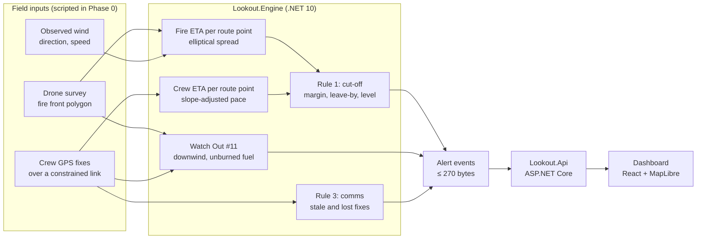

# Lookout

**Escape-route cut-off warnings for wildland fire crews.** Lookout compares where the fire will be with how long a crew needs to walk out, and tells the crew when to leave: *"LEAVE NOW via ER-1 to SZ-1. Fire at route 14:28."*

The name comes from LCES (Lookouts, Communications, Escape routes, Safety zones), the wildland firefighting safety doctrine. Lookout tries to automate the lookout's most important call. It is not affiliated with any commercial product of the same name.


> **Status: Phase 0, simulation only.** This is a portfolio project. It runs scripted scenarios on real terrain. It is not a fire behavior model, has not been validated in the field, and must not be used for real operational decisions.

## What it does

- **Predicts when the fire reaches each point of a crew's escape route,** using the elliptical fire-shape model from FARSITE with the wind observed right now.
- **Predicts when the crew reaches each point,** walking at slope-adjusted rates measured from GPS-tracked hotshot crews.
- **Turns the gap into a decision:** a must-leave-by time, a safety margin, and an alert level that escalates as the margin shrinks.
- **Watches the link:** if a crew's GPS fixes stop arriving, it flags the stale position and escalates to the incident commander.
- **Keeps every alert small:** each one fits in a 270-byte satellite downlink message, and every level change is logged.

## The demo scenario

[`scenarios/pine-valley-wind-shift.yaml`](scenarios/pine-valley-wind-shift.yaml) is a fictional incident on real terrain in the hills between Veyo and Pine Valley, north of St. George, Utah.

1. A fire ignites at 13:30 and backs and flanks slowly under a light north wind.
2. At 14:20 the wind swings 90 degrees to the west, as it did at Yarnell Hill in 2013. The fire's head turns toward Crew Alpha's work site and the start of their uphill escape route.
3. Lookout only knows the current wind, so the shift is the first moment it can see the threat. It goes CRITICAL on that update, 8.5 minutes before the fire reaches the route.
4. Crew Alpha moves out at 14:21:30 and reaches the safety zone at 14:34. Crew Bravo is never threatened by the fire but drops off the link for 17 minutes.

```text
$ dotnet run --project src/Lookout.Sim

Alert log
  14:07:00  BRAVO  None     -> Watch      49 B  BRAVO WATCH: Comms stale: last position 5 min old
  14:17:00  BRAVO  Watch    -> Warning    71 B  BRAVO WARNING: COMMS LOST: no position for 15 min, IC check in by radio
  14:19:00  BRAVO  Warning  -> None       23 B  BRAVO no active alerts.
  14:20:00  ALPHA  None     -> Critical   77 B  ALPHA CRITICAL: LEAVE NOW via ER-1 to SZ-1. Fire at route 14:28, margin 8 min
  14:26:00  ALPHA  Critical -> Warning    69 B  ALPHA WARNING: En route via ER-1 to SZ-1, arrive 14:35, margin 19 min
  14:28:00  ALPHA  Warning  -> Watch      67 B  ALPHA WATCH: En route via ER-1 to SZ-1, arrive 14:35, margin 30 min
  14:30:00  ALPHA  Watch    -> None       23 B  ALPHA no active alerts.

Truth scorecard
  ER-1: fire reaches route at 14:28
  ALPHA: reached safety zone 14:34, burnover never, first cut-off warning 8.5 min before the cut
```

The scenario is also the acceptance test. [`DemoScenarioTests`](tests/Lookout.Engine.Tests/DemoScenarioTests.cs) fails the build if the warning comes later than 6 minutes before the cut, if Alpha is burned over, or if any alert exceeds 270 bytes.


## How it works



### Rule 1: escape-route cut-off

For every point on the crew's remaining route, Lookout compares the fire's predicted arrival time T1 with the crew's arrival time T2 if they leave now. This is the safety-margin formulation from the trigger-buffer research of Fryer, Dennison and Cova (2013).

```text
margin     = min over remaining route of (T1 - T2)
leave by   = now + margin - buffer            (buffer = 10 min)
level      = minutes until leave-by:  < 30 WATCH,  < 15 WARNING,  < 5 CRITICAL
```

**Fire arrival.** A fire growing from a point under constant wind is an ellipse with the ignition at its rear focus (Anderson 1983). The shape comes from the FARSITE length-to-breadth relationship (Finney 1998, eq. 13), with U the midflame wind in m/s, capped at 8:

```text
LB     = 0.936·e^(0.2566·U) + 0.461·e^(−0.1548·U) − 0.397
e      = √(LB² − 1) / LB
R(γ)   = R_head · (1 − e) / (1 − e·cos γ)      spread rate at angle γ from the head
```

The predicted arrival time at a point is the fastest elliptical spread time from any point on the current front. That is Huygens' principle, and it matches the scripted fire exactly on flat ground, which a unit test checks.

**Crew arrival.** Each route is resampled every 20 m with real ground elevation from USGS 3DEP. Walking speed comes from Sullivan et al. (2020), a travel-rate model fitted to GPS tracks of eleven hotshot crews carrying gear on trails. On the moderate setting it gives 1.38 m/s on flat ground, 0.90 m/s at +15°, and 0.55 m/s at +30°. A crew that is off the route is assumed to travel at half speed until it reaches it.

**Wind is not forecast.** The engine uses the wind observed now and holds it constant. That is why the demo's warning arrives at the moment of the shift and not before. A forecast feed can plug into the same rule later.

### Watch Out #11: unburned fuel between you and the fire

A crew is flagged when it is outside the burned area, within 500 m of the front, and within 45 degrees of the fire's downwind direction. Phase 0 has no fuel map, so "unburned" means outside the burned polygon.

### Rule 3: communications

Crew positions arrive as GPS fixes over the link. A fix older than 5 minutes is stale. At 15 minutes it escalates to the incident commander, matching the dispatch check-in timer used for aircraft flight following.

Every default above is a scenario setting with its source listed in [docs/assumptions.md](docs/assumptions.md).

## What Lookout does not model

- **Terrain and fuel effects on spread.** Phase 0 spreads fire on flat, uniform fuel. Terrain only affects crew walking speed. A grid-based minimum-travel-time model, the method FlamMap uses, is planned for Phase 1.
- **The head-fire rate itself.** It is a scenario input, never computed from fuel moisture or fuel models.
- **Spotting, crown fire, fire acceleration, diurnal winds, and suppression.**
- **Wind forecasts.** Only observed wind is used.

## Run it

Everything in one command, with the dashboard at http://localhost:8080:

```bash
docker compose up --build
```

For development you need .NET 10 and Node 22 or later.

```bash
dotnet test
```

```bash
dotnet run --project src/Lookout.Sim -- scenarios/pine-valley-wind-shift.yaml
```

```bash
dotnet run --project src/Lookout.Api
```

```bash
npm --prefix web install && npm --prefix web run dev
```

The API listens on port 5080 and the dashboard on http://localhost:5173. Add `?t=20` to the dashboard URL to open the replay at minute 20.

## Project layout

| Path | What it is |
|---|---|
| `src/Lookout.Engine` | Spread model, travel rates, rules, scenario loader, simulator. No web dependencies. |
| `src/Lookout.Api` | ASP.NET Core minimal API that serves scenario timelines as JSON. |
| `src/Lookout.Sim` | Console runner that prints the alert log and truth scorecard. |
| `tests/Lookout.Engine.Tests` | xUnit v3 tests: formulas, travel rates, the scripted fire, and the demo acceptance test. |
| `web` | Vite + React + TypeScript dashboard on MapLibre GL JS. |
| `scenarios` | Scenario YAML files: fire, wind phases, routes, safety zones, crew tracks. |
| `docs/assumptions.md` | Every default parameter, its source, and the open questions for a working firefighter. |

## Roadmap

1. **Phase 1.** Grid minimum-travel-time spread over terrain, with a trigger-buffer polygon on the map. Crew alerts and positions over MQTT with a byte and rate governor in both directions. A PostgreSQL event log with TimescaleDB and PostGIS. Acknowledgement workflow with observer and incident-commander roles, optimistic concurrency, and an immutable audit trail. Live wind from the National Weather Service API. Cursor on Target export to a TAK server.
2. **Phase 2.** Drone input: a flight track parsed from DJI `.SRT` logs, and a pretrained fire detector run on public drone footage of prescribed burns, producing the fire-front polygon that the scenario currently scripts.
3. **Phase 3.** A live drone video feed on Android, on-device inference, and a crew phone app with real GPS and push alerts.

## Drone safety

Lookout never needs a drone near a real fire. Drones near wildfires ground firefighting aircraft. Flying inside a wildfire temporary flight restriction is a federal crime with civil penalties up to $20,000. All drone work in this project uses public datasets or flights over a legal backyard fire pit, under FAA recreational rules: TRUST certificate, under 400 ft, visual line of sight, and an airspace check with an FAA-approved app.

## References

- Anderson, H. E. (1983). *Predicting wind-driven wild land fire size and shape.* USDA Forest Service Research Paper INT-305.
- Finney, M. A. (1998). *FARSITE: Fire Area Simulator, model development and evaluation.* USDA Forest Service RMRS-RP-4.
- Andrews, P. L. (2018). *The Rothermel surface fire spread model and associated developments.* USDA Forest Service RMRS-GTR-371.
- Fryer, G. K., Dennison, P. E., & Cova, T. J. (2013). Wildland firefighter entrapment avoidance: modelling evacuation triggers. *International Journal of Wildland Fire*, 22(7), 883–893.
- Sullivan, P. R., Campbell, M. J., Dennison, P. E., Brewer, S. C., & Butler, B. W. (2020). Modeling wildland firefighter travel rates by terrain slope: results from GPS-tracking of Type 1 crew movement. *Fire*, 3(3), 52.
- NWCG (2025). *Incident Response Pocket Guide*, PMS 461: LCES and the 18 Watch Out Situations.

Map data © OpenStreetMap contributors, OpenMapTiles, served by OpenFreeMap. Terrain from Mapterhorn, derived from USGS 3DEP. Route elevations from the USGS Elevation Point Query Service.

## License

MIT. See [LICENSE](LICENSE).
