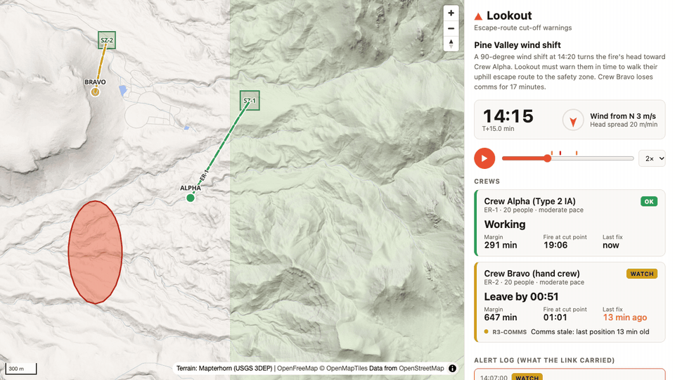
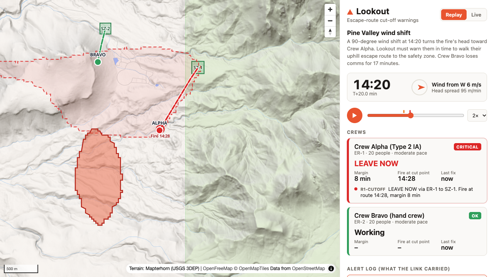
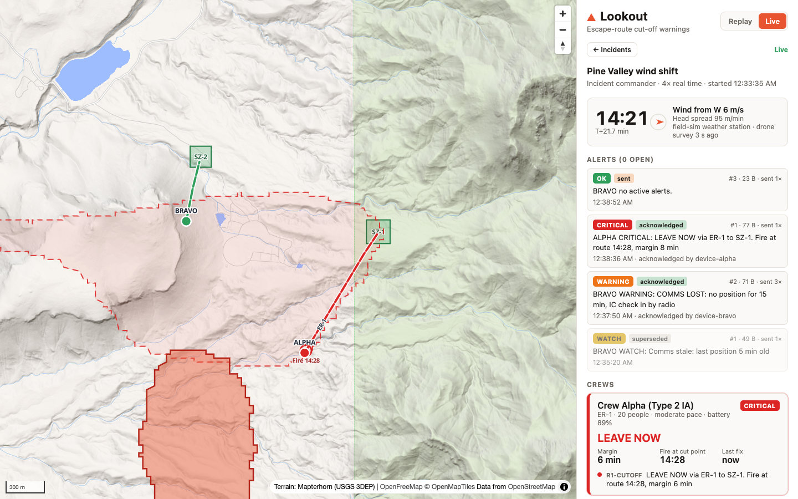
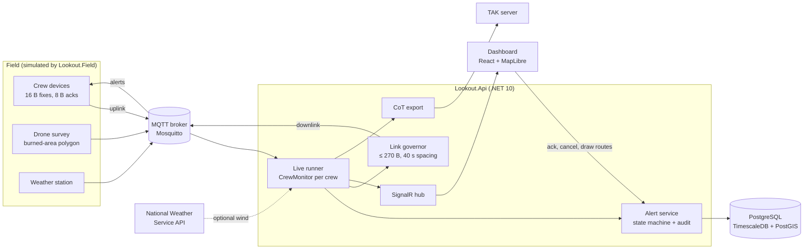
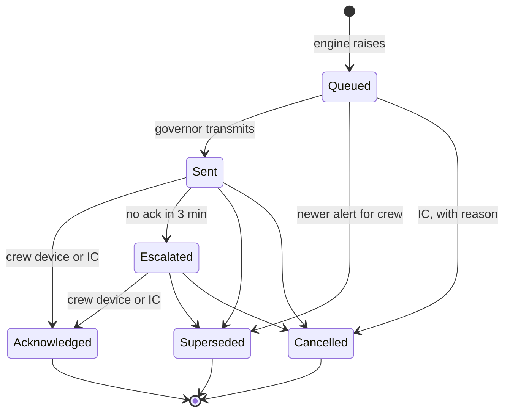

# Lookout

**Escape-route cut-off warnings for wildland fire crews.** Lookout compares where the fire will be with how long a crew needs to walk out, and tells the crew when to leave: *"LEAVE NOW via ER-1 to SZ-1. Fire at route 14:28."* The warning travels over a link sized like a satellite messenger, and every step of it is recorded in an append-only audit trail.

The name comes from LCES (Lookouts, Communications, Escape routes, Safety zones), the wildland firefighting safety doctrine. Lookout tries to automate the lookout's most important call. It is not affiliated with any commercial product of the same name.



> **Status: Phase 1 of 3, simulation only.** This is a portfolio project. It runs scripted scenarios on real terrain, live or as a replay. It is not a validated fire behavior model and must not be used for real operational decisions.

## What it does

- **Predicts when the fire reaches each point of a crew's escape route,** over real terrain, using the minimum-travel-time method that FlamMap uses, with elliptical spread from the wind observed now.
- **Predicts when the crew reaches each point,** walking at slope-adjusted rates measured from GPS-tracked hotshot crews.
- **Turns the gap into a decision:** a must-leave-by time, a safety margin, an alert level, and a "leave-now zone" on the map. If the fire front enters that zone, the crew must already be moving.
- **Watches the link:** if a crew's GPS fixes stop arriving, it flags the stale position and escalates to the incident commander.
- **Delivers warnings over a constrained link:** 16-byte position reports up, alerts of at most 270 bytes down, spaced like satellite modem sessions and repeated until acknowledged.
- **Runs the acknowledgement workflow** with roles, optimistic concurrency, escalation, and an audit trail the database refuses to rewrite.
- **Exports to TAK:** crew positions, the fire perimeter, and cut-off markers as Cursor on Target events.

## The demo scenario

[`scenarios/pine-valley-wind-shift.yaml`](scenarios/pine-valley-wind-shift.yaml) is a fictional incident on real terrain in the hills between Veyo and Pine Valley, north of St. George, Utah.

1. A fire ignites at 13:30 and backs and flanks slowly under a light north wind.
2. At 14:20 the wind swings 90 degrees to the west, as it did at Yarnell Hill in 2013. The fire's head turns toward Crew Alpha's work site and the start of their uphill escape route.
3. Lookout only knows the current wind, so the shift is the first moment it can see the threat. It goes CRITICAL on that update, 8 minutes before the fire reaches the route.
4. Crew Alpha moves out at 14:21:30 and reaches the safety zone at 14:34. Crew Bravo is never threatened by the fire but drops off the link for 17 minutes.

```text
$ dotnet run --project src/Lookout.Sim

Alert log
  14:07:00  BRAVO  None     -> Watch      49 B  BRAVO WATCH: Comms stale: last position 5 min old
  14:17:00  BRAVO  Watch    -> Warning    71 B  BRAVO WARNING: COMMS LOST: no position for 15 min, IC check in by radio
  14:20:00  ALPHA  None     -> Critical   77 B  ALPHA CRITICAL: LEAVE NOW via ER-1 to SZ-1. Fire at route 14:28, margin 8 min
  14:21:00  BRAVO  Warning  -> None       23 B  BRAVO no active alerts.
  14:30:00  ALPHA  Critical -> Watch      67 B  ALPHA WATCH: En route via ER-1 to SZ-1, arrive 14:35, margin 35 min
  14:34:00  ALPHA  Watch    -> None       23 B  ALPHA no active alerts.

Truth scorecard
  ER-1: fire reaches route at 14:28
  ALPHA: reached safety zone 14:34, burnover never, first cut-off warning 8.0 min before the cut
```

The scenario is also the acceptance test. [`DemoScenarioTests`](tests/Lookout.Engine.Tests/DemoScenarioTests.cs) fails the build if the warning comes later than 6 minutes before the cut, if Alpha is burned over, if Alpha's level flaps back up while walking out, or if any alert exceeds 270 bytes.



## Live mode

The same scenario can run live. A field simulator plays it in over MQTT the way the field would: crew GPS fixes, drone surveys of the burned area, and weather. The engine watches it in real time, sends alerts down each crew's link, and the incident commander works the dashboard.



During the live run of the demo:

- Bravo's COMMS LOST warning is sent while its device is out of contact. The governor repeats it, the device receives it when contact returns, and acknowledges it.
- Alpha's CRITICAL goes out on the update after the wind shift and is acknowledged by the crew's device seconds later.
- If a crew never acknowledges a WARNING or CRITICAL, the alert escalates to the incident commander after 3 scenario minutes, and the IC can acknowledge on the crew's behalf.

## How it works



### Rule 1: escape-route cut-off

For every point on the crew's remaining route, Lookout compares the fire's predicted arrival time T1 with the crew's arrival time T2 if they leave now. This is the safety-margin formulation from the trigger-buffer research of Fryer, Dennison and Cova (2013).

```text
margin     = min over remaining route of (T1 - T2)
leave by   = now + margin - buffer            (buffer = 10 min)
level      = minutes until leave-by:  < 30 WATCH,  < 15 WARNING,  < 5 CRITICAL
```

**Fire arrival.** The terrain is a 30 m elevation grid from USGS 3DEP. Each cell connects to 16 neighbours. Fire travel time along an edge comes from the elliptical fire shape of Anderson (1983), with the FARSITE length-to-breadth relationship (Finney 1998, eq. 13), where U is the midflame wind in m/s, capped at 8:

```text
LB     = 0.936·e^(0.2566·U) + 0.461·e^(−0.1548·U) − 0.397
e      = √(LB² − 1) / LB
R(γ)   = R_head · (1 − e) / (1 − e·cos γ)      spread rate at angle γ from the head
```

Spread doubles for every 10 degrees of upslope along an edge, capped at 30 degrees. One reverse Dijkstra run from the crew's remaining route gives the margin from wherever the front is, and the leave-now zone. On flat ground the grid agrees with the closed-form ellipse, and unit tests check that.

**Crew arrival.** Each route is resampled every 20 m with real ground elevation. Walking speed comes from Sullivan et al. (2020), a travel-rate model fitted to GPS tracks of eleven hotshot crews carrying gear on trails. On the moderate setting it gives 1.38 m/s on flat ground, 0.90 m/s at +15°, and 0.55 m/s at +30°.

**Hysteresis.** Escalations go out at once. A downgrade goes out only after the lower level has held for 2 minutes, so a margin sitting on a threshold cannot flap over the link.

**Wind is not forecast.** The engine uses the wind observed now and holds it constant. That is why the demo's warning arrives at the moment of the shift and not before.

### Watch Out #11 and Rule 3

A crew is flagged under Watch Out #11 when it is outside the burned area, within 500 m of the front, and within 45 degrees of the fire's downwind direction. Rule 3 marks a crew's position stale after 5 minutes without a fix, and escalates at 15 minutes, matching the dispatch check-in timer used for aircraft flight following.

Every default is a scenario setting with its source listed in [docs/assumptions.md](docs/assumptions.md).

### The crew link

Sizes follow Iridium Short Burst Data: 340 bytes from the crew, 270 bytes to the crew. The formats are fixed binary layouts, big-endian, defined in [`WireFormat.cs`](src/Lookout.Link/WireFormat.cs).

| Message | Direction | Bytes | Fields |
|---|---|---|---|
| Position | crew to server | 16 | type, battery %, sequence, Unix time, latitude and longitude in 1e-7 degrees |
| Acknowledgement | crew to server | 8 | type, alert link sequence, Unix time |
| Alert | server to crew | at most 270 | type, level, link sequence, leave-by minute of day, UTF-8 text |

The [`LinkGovernor`](src/Lookout.Link/LinkGovernor.cs) keeps one outbound slot per crew, so a newer alert replaces an older unacknowledged one. It spaces transmissions to one device 40 seconds apart, sends the most severe crew first, and repeats warnings every 60 seconds until acknowledged. It runs on scenario time, so an accelerated demo keeps realistic link behaviour.

Drone surveys and weather travel as JSON on a separate broadband link, as they would over a Starlink or LTE backhaul. TAK export is built on the server only, because a minimal Cursor on Target position is about 400 bytes of XML.

### Alert workflow



- **Every transition is listed in one place,** [`AlertStateMachine.cs`](src/Lookout.Engine/Workflow/AlertStateMachine.cs). Anything not listed is refused with HTTP 409.
- **Optimistic concurrency.** Alerts, routes and safety zones carry PostgreSQL's `xmin` as a row version. A client must send the version it saw. A stale version gets a 409 with the current state, and two simultaneous acknowledgements resolve to exactly one success.
- **Roles.** The incident commander can start incidents, acknowledge for any crew, cancel with a reason, and redraw routes and safety zones. A crew device can acknowledge only its own alerts. An observer can only watch.
- **Audit.** Each alert change and its audit event are saved in one transaction. The audit table is a TimescaleDB hypertable, and a database trigger rejects UPDATE, DELETE and TRUNCATE.

Sign-in uses development tokens issued by the API. A real deployment would use the organisation's identity provider instead.

### Data model

| Table | Purpose |
|---|---|
| `incidents` | A live run of a scenario: start time, clock rate, wind source, status |
| `crews` | Crews in an incident and their assigned routes |
| `escape_routes` | PostGIS `LineStringZ` with ground elevation, versioned |
| `safety_zones` | PostGIS `Polygon`, versioned |
| `alerts` | Each alert, its link sequence, state, and acknowledgement, versioned |
| `audit_events` | Append-only hypertable: who did what, when, with JSON details |
| `crew_fixes` | Hypertable of every position received over the link |

Migrations are EF Core, with one hand-written migration for the hypertables and the append-only trigger.

## What Lookout does not model

- **Fuel.** Spread uses one head-fire rate per weather phase over uniform fuel. Terrain affects spread through slope only. The head-fire rate is a scenario input, never computed from fuel models or fuel moisture.
- **Spotting, crown fire, fire acceleration, diurnal winds, and suppression.**
- **Wind forecasts.** Only observed wind is used: from the field, or from the nearest National Weather Service station when an incident is set to NWS.
- **Real drone detection.** The drone survey is the scenario's simulated fire. Phase 2 replaces it with a detector.

## Run it

Everything in one command:

```bash
docker compose up --build
```

- **Replay:** open http://localhost:8080. It works without signing in.
- **Live:** switch to Live and sign in as incident commander. The `field` service has already started an incident at 4× real time and is playing the demo scenario into it.

For development you need .NET 10, Node 22 or later, and Docker for PostgreSQL, Mosquitto and the integration tests.

```bash
dotnet test
```

```bash
dotnet run --project src/Lookout.Sim -- scenarios/pine-valley-wind-shift.yaml
```

```bash
docker compose up -d db mqtt
```

```bash
dotnet run --project src/Lookout.Api
```

```bash
MQTT_USER=lookout MQTT_PASSWORD=lookout-dev-mqtt CLOCK_RATE=8 dotnet run --project src/Lookout.Field
```

```bash
npm --prefix web install && npm --prefix web run dev
```

The dev API listens on port 5080 and the dashboard on http://localhost:5173. Add `?t=20` to a replay URL to open it at minute 20. Set `NO_ACK_CREWS=BRAVO` on the field simulator to watch an alert escalate.

## Project layout

| Path | What it is |
|---|---|
| `src/Lookout.Engine` | Terrain grid, spread models, travel rates, rules, alert state machine, scenario loader, replay simulator. No web or database dependencies. |
| `src/Lookout.Link` | Wire formats, link governor, MQTT connection. Shared by the server and the field simulator. |
| `src/Lookout.Api` | ASP.NET Core: replay API, live runner, alert and incident services, EF Core data model, SignalR hub, NWS client, CoT export. |
| `src/Lookout.Field` | Field simulator: plays a scenario's truth over MQTT and simulates crew devices. |
| `src/Lookout.Sim` | Console runner for replays, and the `dem` command that builds a scenario's terrain grid. |
| `tests/Lookout.Engine.Tests` | Formulas, grid oracles, travel rates, latch, state machine, wire formats, governor, demo acceptance. |
| `tests/Lookout.Api.Tests` | Integration tests on a TimescaleDB container, plus CoT and NWS parsing. |
| `web` | Vite + React + TypeScript dashboard on MapLibre GL JS, with Replay and Live modes. |
| `scenarios` | Scenario YAML files and their terrain grids. |
| `deploy/mosquitto` | Broker configuration with a development password file. |

## Roadmap

1. **Phase 1, done.** Terrain-aware engine, live incidents over MQTT, the link governor, the acknowledgement workflow, the audit trail, TAK export, and NWS weather.
2. **Phase 2, next.** Drone input: a flight track parsed from DJI `.SRT` logs, and a pretrained fire detector run on public drone footage of prescribed burns, producing the fire-front polygon the scenario currently scripts.
3. **Phase 3.** A live drone video feed on Android, on-device inference, and a crew phone app with real GPS and push alerts.

## Drone safety

Lookout never needs a drone near a real fire. Drones near wildfires ground firefighting aircraft. Flying inside a wildfire temporary flight restriction is a federal crime with civil penalties up to $20,000. All drone work in this project uses public datasets or flights over a legal backyard fire pit, under FAA recreational rules: TRUST certificate, under 400 ft, visual line of sight, and an airspace check with an FAA-approved app.

## References

- Anderson, H. E. (1983). *Predicting wind-driven wild land fire size and shape.* USDA Forest Service Research Paper INT-305.
- Finney, M. A. (1998). *FARSITE: Fire Area Simulator, model development and evaluation.* USDA Forest Service RMRS-RP-4.
- Finney, M. A. (2002). Fire growth using minimum travel time methods. *Canadian Journal of Forest Research*, 32(8), 1420–1424.
- Andrews, P. L. (2018). *The Rothermel surface fire spread model and associated developments.* USDA Forest Service RMRS-GTR-371.
- Fryer, G. K., Dennison, P. E., & Cova, T. J. (2013). Wildland firefighter entrapment avoidance: modelling evacuation triggers. *International Journal of Wildland Fire*, 22(7), 883–893.
- Sullivan, P. R., Campbell, M. J., Dennison, P. E., Brewer, S. C., & Butler, B. W. (2020). Modeling wildland firefighter travel rates by terrain slope: results from GPS-tracking of Type 1 crew movement. *Fire*, 3(3), 52.
- NWCG (2025). *Incident Response Pocket Guide*, PMS 461: LCES and the 18 Watch Out Situations.

Map data © OpenStreetMap contributors, OpenMapTiles, served by OpenFreeMap. Terrain from AWS Terrain Tiles and Mapterhorn, derived from USGS 3DEP. Weather from the National Weather Service API.

## License

MIT. See [LICENSE](LICENSE).
