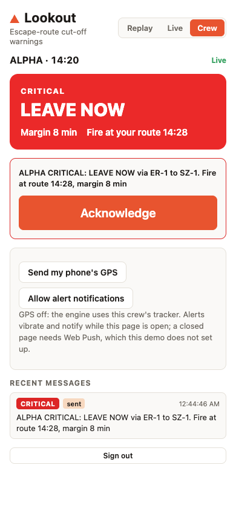
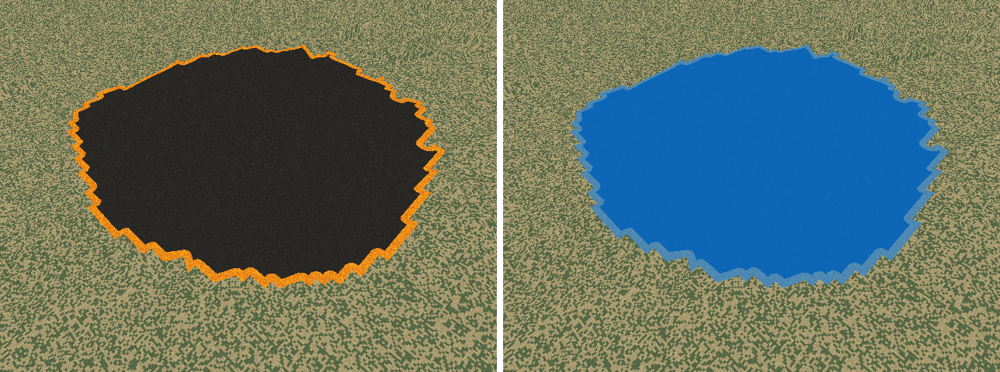
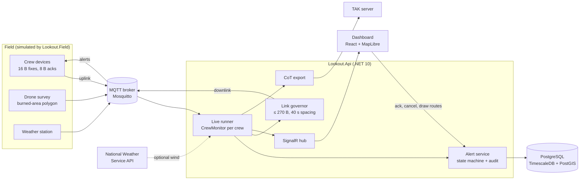
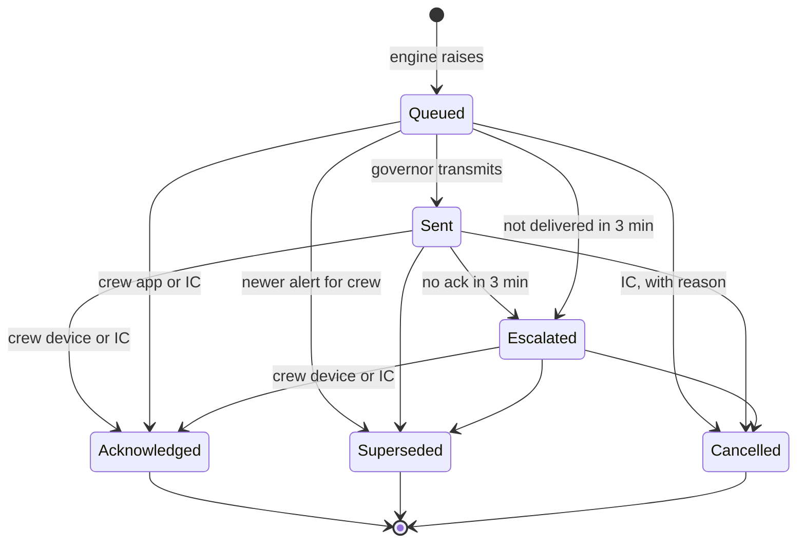

# Lookout

[](https://github.com/BrandonBodilyDev/lookout/actions/workflows/ci.yml)

**Escape-route cut-off warnings for wildland fire crews.** Lookout compares where the fire will be with how long a crew needs to walk out, and tells the crew when to leave: *"LEAVE NOW via ER-1 to SZ-1. Fire at route 14:28."* The warning travels over a link sized like a satellite messenger, and every step of it is recorded in an append-only audit trail.

The name comes from LCES (Lookouts, Communications, Escape routes, Safety zones), the wildland firefighting safety doctrine. Lookout tries to automate the lookout's most important call. It is not affiliated with any commercial product of the same name.


> **Status: Phases 1 and 2 built, Phase 3 started.** The drone pipeline is tested on synthetic footage only. This is a portfolio project. It runs scripted scenarios on real terrain, live or as a replay, and its drone pipeline has not yet been run on real fire footage. It is not a validated fire behavior model and must not be used for real operational decisions.

## What it does

- **Predicts when the fire reaches each point of a crew's escape route,** over real terrain, using the minimum-travel-time method that FlamMap uses, with elliptical spread from the wind observed now.
- **Predicts when the crew reaches each point,** walking at slope-adjusted rates measured from GPS-tracked hotshot crews.
- **Turns the gap into a decision:** a must-leave-by time, a safety margin, an alert level, and a "leave-now zone" on the map. If the fire front enters that zone, the crew must already be moving.
- **Weighs every escape route:** works from whichever route still clears and tells the crew which to avoid.
- **Watches the link:** if a crew's GPS fixes stop arriving, it flags the stale position and escalates to the incident commander.
- **Delivers warnings over a constrained link:** 16-byte position reports up, alerts of at most 270 bytes down, spaced like satellite modem sessions and repeated until acknowledged.
- **Runs the acknowledgement workflow** with roles, optimistic concurrency, escalation, and an audit trail the database refuses to rewrite.
- **Reaches the crew's phone:** a mobile view with one-tap acknowledgement, optional phone GPS, and Web Push for a closed page.
- **Exports to TAK:** crew positions, the fire perimeter, and cut-off markers as Cursor on Target events.

## The demo scenario

[`scenarios/pine-valley-wind-shift.yaml`](scenarios/pine-valley-wind-shift.yaml) is a fictional incident on real terrain in the hills between Veyo and Pine Valley, north of St. George, Utah.

1. A fire ignites at 13:30 and backs and flanks slowly under a light north wind.
2. At 14:20 the wind swings 90 degrees to the west, as it did at Yarnell Hill in 2013. The fire's head turns toward Crew Alpha's work site and the start of their uphill escape route.
3. Lookout only knows the current wind, so the shift is the first moment it can see the threat. It goes CRITICAL on that update, 8 minutes before the fire reaches the route.
4. Crew Alpha moves out at 14:21:30 and reaches the safety zone at 14:34. Crew Bravo is never threatened by the fire but drops off the link for 17 minutes.

```text
$ dotnet run --project src/Lookout.Sim

Alert log
  14:07:00  BRAVO  None     -> Watch      49 B  BRAVO WATCH: Comms stale: last position 5 min old
  14:17:00  BRAVO  Watch    -> Warning    71 B  BRAVO WARNING: COMMS LOST: no position for 15 min, IC check in by radio
  14:20:00  ALPHA  None     -> Critical  105 B  ALPHA CRITICAL: LEAVE NOW via ER-1 to SZ-1. Fire at route 14:28, margin 8 min. Avoid ER-1B (2 min margin)
  14:21:00  BRAVO  Warning  -> None       23 B  BRAVO no active alerts.
  14:30:00  ALPHA  Critical -> Watch      86 B  ALPHA WATCH: En route via ER-1 to SZ-1, arrive 14:35, margin 35 min. Avoid ER-1B (cut)
  14:34:00  ALPHA  Watch    -> None       23 B  ALPHA no active alerts.

Truth scorecard
  ER-1: fire reaches route at 14:28
  ER-1B: fire reaches route at 14:26
  ALPHA: reached safety zone 14:34, burnover never, first cut-off warning 8.0 min before the cut
```

A second scenario, [`pine-valley-steady-north.yaml`](scenarios/pine-valley-steady-north.yaml), is the control: the same fire and terrain, with no wind shift and no gap in Bravo's position reports. Lookout must raise no alerts at all there, and a test enforces it. A warning system that cries wolf gets ignored.

The demo scenario is also the acceptance test. [`DemoScenarioTests`](tests/Lookout.Engine.Tests/DemoScenarioTests.cs) fails the build if the warning comes later than 6 minutes before the cut, if Alpha is burned over, if Alpha's level flaps back up while walking out, or if any alert exceeds 270 bytes.


## Live mode

The same scenario can run live. A field simulator plays it in over MQTT the way the field would: crew GPS fixes, drone surveys of the burned area, and weather. The engine watches it in real time, sends alerts down each crew's link, and the incident commander works the dashboard.


During the live run of the demo:

- Bravo's COMMS LOST warning is sent while its device is out of contact. The governor repeats it, the device receives it when contact returns, and acknowledges it.
- Alpha's CRITICAL goes out on the update after the wind shift and is acknowledged by the crew's device seconds later.
- If a crew never acknowledges a WARNING or CRITICAL, the alert escalates to the incident commander after 3 scenario minutes, and the IC can acknowledge on the crew's behalf.

The field simulator assigns one simulated link device to each crew when it starts the incident. The incident commander can assign or remove devices from the dashboard, which shows when each device was last heard and its battery. A device that reports without being assigned is listed there with one-click assignment, because its positions are being ignored. A crew with no device shows that its link alerts are waiting. Web Push to the crew's phones still goes out.

### The crew's phone

The Crew tab is what a crew member sees. It shows one status card colored by alert level, one large Acknowledge button for the current warning, and the last few messages.



- **Acknowledgements** use the same workflow, roles and version checks as the dashboard. A crew can acknowledge only its own alerts.
- **Phone GPS is optional.** A phone without a satellite modem posts its position over HTTPS. The API packs it into the same 16-byte position report a tracker sends over the link and feeds it through the same code path.
- **Push alerts wake a closed phone.** With "Enable push alerts", each new WARNING or CRITICAL is also sent by Web Push (VAPID-signed, encrypted, high urgency for CRITICAL, 15-minute time-to-live), so it arrives with the page closed. On iPhone this works only for the web app added to the home screen. A test runs the server side against a fake push service on localhost; delivery to a real phone has not been tried yet.

## Drone input

The fire front can come from a drone instead of the scenario. The pipeline, in [`src/Lookout.Drone`](src/Lookout.Drone), works on an ordinary video file:

1. **Track.** Read the DJI subtitle track: one GPS fix and height per second on the original Mavic Mini, longitude first, 4 decimal places (about 11 m). ffmpeg extracts it from the MP4.
2. **Pose.** Heading and gimbal pitch are not in the subtitle track. They come from an Airdata-style flight-log CSV, or are given on the command line for a straight-down survey.
3. **Detect.** Find fire in each frame. The default detector needs no trained weights: flame pixels must pass the RGB rule of Chen et al. (2004) and the chrominance rule of Celik and Demirel (2009). The chrominance rule is there because Chen's rule alone accepts dry tan grass, which covers most of the ground in desert scrub. A DETR-family ONNX model can be used instead, run through ONNX Runtime in .NET. That path is tested with a tiny generated model that has the same interface as an RF-DETR export; real weights have not been run yet.
4. **Project.** Turn fire pixels into ground positions with a pinhole camera model, intersecting each ray with the terrain grid.
5. **Map.** Mark burned cells on the 30 m grid, accumulate them across frames, and polygonize. The result is the same fire-front message the engine already consumes, and it can be published straight into a live incident.

```bash
dotnet run --project src/Lookout.Sim -- drone survey scenarios/pine-valley-wind-shift.yaml DJI_0001.MP4 --heading 0 --pitch -90 --publish <incident-id>
```

Publishing needs the broker login in `MQTT_USER` and `MQTT_PASSWORD`, as in the [drone runbook](docs/drone-runbook.md).

**How it is tested without real footage.** A synthetic camera renders the scenario's true fire as an aerial image: flame along the edge, burn scar inside, vegetation outside. Two tests score the pipeline against the truth:



| Test | Result required |
|---|---|
| One rendered frame, detected and mapped | IoU above 0.85 with the true fire |
| A generated MP4 with a Mavic-Mini-format subtitle track, through ffmpeg and the full survey | IoU above 0.75, including video compression and 4-decimal GPS |

With the virtual camera and detector feeding the engine in a full replay (`dotnet run --project src/Lookout.Sim -- --camera`), the alert timeline is unchanged: CRITICAL at 14:20, 8 minutes before the cut. Synthetic images are far easier than real smoke, glare and shadow, so this shows the geometry and plumbing are right, not that detection is solved.

**What a Mavic Mini can and cannot do here.** At its 120 m ceiling, a straight-down frame covers about 170 by 100 m. That is enough to map a fire-pit test or the edge of a small burn, not a 2 km fire. The field simulator's camera mode uses a virtual camera at 1,800 m, where one frame covers about 2.6 by 1.9 km. That altitude matches an incident-awareness aircraft or a Group 3 UAS, not a consumer drone. The original Mavic Mini also reached end of service in April 2026, and it stands in here for a production airframe.

**Recommended trained weights.** Use Apache-2.0 models such as RF-DETR fire detectors. Ultralytics YOLO weights are AGPL-3.0, and using them would change this project's license. No model or dataset is committed to this repo.

## How it works



### Rule 1: escape-route cut-off

For every point on the crew's remaining route, Lookout compares the fire's predicted arrival time T1 with the crew's arrival time T2 if they leave now. This is the safety-margin formulation from the trigger-buffer research of Fryer, Dennison and Cova (2013).

```text
margin     = min over remaining route of (T1 - T2)
leave by   = now + margin - buffer            (buffer = 10 min)
level      = minutes until leave-by:  < 30 WATCH,  < 15 WARNING,  < 5 CRITICAL
```

**Fire arrival.** The terrain is a 30 m elevation grid from USGS 3DEP. Each cell connects to 16 neighbours. Fire travel time along an edge comes from the elliptical fire shape of Anderson (1983), with the FARSITE length-to-breadth relationship (Finney 1998, eq. 13), where U is the midflame wind in m/s and the ratio is clamped to 1–8:

```text
LB     = 0.936·e^(0.2566·U) + 0.461·e^(−0.1548·U) − 0.397
e      = √(LB² − 1) / LB
R(γ)   = R_head · (1 − e) / (1 − e·cos γ)      spread rate at angle γ from the head
```

Spread doubles for every 10 degrees of upslope along an edge, capped at 30 degrees. One reverse Dijkstra run from the crew's remaining route gives the margin from wherever the front is, and the leave-now zone. On flat ground the grid agrees with the closed-form ellipse, and unit tests check that.

**Crew arrival.** Each route is resampled every 20 m with real ground elevation. Walking speed comes from Sullivan et al. (2020), a travel-rate model fitted to GPS tracks of eleven hotshot crews carrying gear on trails. On the moderate setting it gives 1.38 m/s on flat ground, 0.90 m/s at +15°, and 0.55 m/s at +30°.

**Several escape routes.** A crew can have more than one route, as the IRPG expects. Lookout evaluates every route each update and works from the one with the largest margin. It names any alternative that would not leave the buffer, so the crew does not take it under pressure. In the demo, Alpha's alternate ER-1B runs west toward the fire's new path: "Avoid ER-1B (2 min margin)" at 14:20, and the fire does reach ER-1B first.

**Hysteresis.** Escalations go out at once. A downgrade goes out only after the lower level has held for 2 minutes, so a margin sitting on a threshold cannot flap over the link.

**Wind is not forecast.** The engine uses the wind observed now and holds it constant. That is why the demo's warning arrives at the moment of the shift and not before.

### Watch Out #11 and Rule 3

A crew is flagged under Watch Out #11 when it is outside the burned area, within 500 m of the front, and within 45 degrees of the fire's downwind direction. Rule 3 marks a crew's position stale after 5 minutes without a fix, and escalates at 15 minutes, matching the dispatch check-in timer used for aircraft flight following.

Every default is a scenario setting with its source listed in [docs/assumptions.md](docs/assumptions.md).

### The crew link

Sizes follow Iridium Short Burst Data: 340 bytes from the crew, 270 bytes to the crew. The formats are fixed binary layouts, big-endian, defined in [`WireFormat.cs`](src/Lookout.Link/WireFormat.cs).

| Message | Direction | Bytes | Fields |
|---|---|---|---|
| Position | crew to server | 16 | type, battery %, sequence, Unix time, latitude and longitude in 1e-7 degrees |
| Acknowledgement | crew to server | 8 | type, alert link sequence, Unix time |
| Alert | server to crew | at most 270 | type, level, link sequence, leave-by minute of day, UTF-8 text |

The [`LinkGovernor`](src/Lookout.Link/LinkGovernor.cs) keeps one outbound slot per crew, so a newer alert replaces an older unacknowledged one. It spaces transmissions to one device 40 seconds apart, sends the most severe crew first, and repeats warnings every 60 seconds until acknowledged. It runs on scenario time, so an accelerated demo keeps realistic link behaviour.

Each device has its own uplink and downlink topic, named by its device id the way an Iridium modem is known by its IMEI. The incident commander assigns devices to crews, and every assignment is audited. An alert for a crew goes to all of its devices.

Drone surveys and weather travel as JSON on a separate broadband link, as they would over a Starlink or LTE backhaul. TAK export is built on the server only, because a minimal Cursor on Target position is about 400 bytes of XML.

### Alert workflow



- **Every transition is listed in one place,** [`AlertStateMachine.cs`](src/Lookout.Engine/Workflow/AlertStateMachine.cs). Anything not listed is refused with HTTP 409.
- **Optimistic concurrency.** Alerts, routes and safety zones carry PostgreSQL's `xmin` as a row version. A client must send the version it saw. A stale version gets a 409 with the current state, and two simultaneous acknowledgements resolve to exactly one success.
- **Undelivered is escalated too.** A WARNING or CRITICAL the link cannot deliver, because the crew has no device or the broker is down, escalates to the incident commander after the same 3 minutes. The governor keeps trying, and a late first delivery is recorded in the audit trail. The crew can still acknowledge it from the phone app, and the IC can acknowledge it for them after reaching them by radio. The after-action summary counts warnings the link never delivered.
- **Roles.** The incident commander can start incidents, acknowledge for any crew, cancel with a reason, and redraw routes and safety zones. A crew device can acknowledge only its own alerts. An observer can only watch.
- **Audit.** Each alert change and its audit event are saved in one transaction. The audit table is a TimescaleDB hypertable, and a database trigger rejects UPDATE, DELETE and TRUNCATE. The API also connects as a restricted role that may only insert into and read the audit table; migrations run as the owner.

Sign-in uses development tokens issued by the API; a real deployment would use the organisation's identity provider. Crew tokens are valid for one incident only. On the broker, the server and the field simulator have separate accounts, and a device login can use only its own two topics. The incident commander assigns each device to a crew, and the server ignores reports from devices that are not assigned, so a device counts for one incident and crew at a time.

### Data model

| Table | Purpose |
|---|---|
| `incidents` | A live run of a scenario: start time, clock rate, wind source, status |
| `crews` | Crews in an incident and their assigned routes |
| `escape_routes` | PostGIS `LineStringZ` with ground elevation, versioned |
| `safety_zones` | PostGIS `Polygon`, versioned |
| `alerts` | Each alert, its link sequence, state, and acknowledgement, versioned |
| `audit_events` | Append-only hypertable: who did what, when, with JSON details |
| `crew_fixes` | Hypertable of every position received over the link, compressed after 7 days, kept 90 |
| `push_subscriptions` | Crew phones registered for Web Push, per incident and crew |
| `devices` | Link devices assigned to crews, versioned; who assigned each and when |

Migrations are EF Core. Hand-written SQL in them creates the hypertables, the append-only trigger, the compression and retention policies, and the runtime role's grants.

## What Lookout does not model

- **Fuel.** Spread uses one head-fire rate per weather phase over uniform fuel. Terrain affects spread through slope only. The head-fire rate is a scenario input, never computed from fuel models or fuel moisture.
- **Spotting, crown fire, fire acceleration, diurnal winds, and suppression.**
- **Wind forecasts.** Only observed wind is used: from the field, or from the nearest National Weather Service station when an incident is set to NWS.
- **Real-world detection accuracy.** The detectors have only been scored on synthetic imagery. Smoke, glare, shadows and red objects will cause errors on real footage.

## Run it

Everything in one command:

```bash
docker compose up --build
```

- **Replay:** open http://localhost:8080. It works without signing in.
- **Ports are bound to localhost,** because development sign-in is on: anyone who can reach the dashboard can get an incident-commander token.
- **Live:** switch to Live and sign in as incident commander. The `field` service has already started an incident at 4× real time and is playing the demo scenario into it.

For development you need .NET 10, Node 22 or later, and Docker for PostgreSQL, Mosquitto and the integration tests.

```bash
dotnet test
```

```bash
dotnet run --project src/Lookout.Sim -- scenarios/pine-valley-wind-shift.yaml
```

```bash
docker compose up -d db mqtt
```

The database is published on localhost 5432 for this. If that port is taken, set `LOOKOUT_DB_PORT` before starting it and change the port in `src/Lookout.Api/appsettings.Development.json` to match.

```bash
dotnet run --project src/Lookout.Api
```

```bash
MQTT_USER=field MQTT_PASSWORD=lookout-dev-field CLOCK_RATE=8 dotnet run --project src/Lookout.Field
```

```bash
npm --prefix web install && npm --prefix web run dev
```

For traces and metrics in the Aspire dashboard at http://localhost:18888 (engine tick duration, alerts raised and escalated, acknowledgement latency, downlink bytes and uplink messages, live loop duration, plus HTTP, database and runtime instrumentation):

```bash
docker compose -f docker-compose.yml -f docker-compose.observability.yml up --build
```

To measure how many crews one incident can evaluate per second:

```bash
dotnet run -c Release --project src/Lookout.Sim -- bench
```

The dev API listens on port 5080 and the dashboard on http://localhost:5173. Add `?t=20` to a replay URL to open it at minute 20. On the field simulator, set `NO_ACK_CREWS=BRAVO` to watch an alert escalate, or `DRONE_MODE=camera` to feed the engine detected fronts instead of the true fire.

## Project layout

| Path | What it is |
|---|---|
| `src/Lookout.Engine` | Terrain grid, spread models, travel rates, rules, alert state machine, scenario loader, replay simulator. No web or database dependencies. |
| `src/Lookout.Link` | Wire formats, link governor, MQTT connection. Shared by the server and the field simulator. |
| `src/Lookout.Drone` | Subtitle-track parser, camera model and ground projection, fire detectors, burned-area mapper, video survey, synthetic camera and flight. |
| `src/Lookout.Api` | ASP.NET Core: replay API, live runner, alert and incident services, EF Core data model, SignalR hub, NWS client, CoT export. |
| `src/Lookout.Field` | Field simulator: plays a scenario's truth over MQTT and simulates crew devices. |
| `src/Lookout.Sim` | Console runner for replays (add `--camera` to put the drone pipeline in the loop), the `drone` commands, and the `dem` command that builds a scenario's terrain grid. |
| `tests/Lookout.Engine.Tests` | Formulas, grid oracles, travel rates, latch, state machine, wire formats, governor, demo and control scenarios, drone pipeline, ONNX path. |
| `tests/Lookout.Api.Tests` | Integration tests on a TimescaleDB container, run as the restricted runtime role: workflow, concurrency, roles, audit, Web Push against a fake push service, MQTT reconnects against a real broker, TAK sender. |
| `web` | Vite + React + TypeScript dashboard on MapLibre GL JS, with Replay, Live and Crew views. |
| `scenarios` | Scenario YAML files and their terrain grids. |
| `deploy/mosquitto` | Broker configuration, access rules, and a development password file. |
| `deploy/postgres` | Database init script that creates the API's restricted runtime login. |
| `tools` | Generator for the tiny ONNX test model. |
| `docs/assumptions.md` | Every default parameter, its source, and the open questions for a working firefighter. |
| `docs/architecture.md` | Design decisions: what was chosen, why, and what it costs. |
| `docs/operations.md` | Configuration, releases, a verified backup-and-restore procedure, what to monitor, and failure behaviour. |
| `docs/drone-runbook.md` | How to run the drone pipeline on real footage: subtitle tracks, FOV calibration, public datasets, trained detectors. |

## Roadmap

1. **Phase 1, done.** Terrain-aware engine, live incidents over MQTT, the device registry, the link governor, the acknowledgement workflow, the audit trail, TAK export, and NWS weather.
2. **Phase 2, built.** The drone pipeline described above: subtitle tracks, ground projection over terrain, color and ONNX detectors, burned-area mapping, and publishing into live incidents. Still to do: run it on real footage, either FLAME 2 prescribed-burn video or a legal fire-pit flight, and calibrate the Mavic Mini's field of view against a ground target.
3. **Phase 3, started.** Done: the crew phone view with acknowledgements, optional phone GPS, and Web Push. Still to do: try push on real Android and iPhone devices, a live drone video feed through DJI Mobile SDK 4 on Android, and on-device inference.

## Drone safety

Lookout never needs a drone near a real fire. Drones near wildfires ground firefighting aircraft. Flying inside a wildfire temporary flight restriction is a federal crime with civil penalties up to $20,000. All drone work in this project uses public datasets or flights over a legal backyard fire pit, under FAA recreational rules: TRUST certificate, under 400 ft, visual line of sight, and an airspace check with an FAA-approved app.

## References

- Anderson, H. E. (1983). *Predicting wind-driven wild land fire size and shape.* USDA Forest Service Research Paper INT-305.
- Finney, M. A. (1998). *FARSITE: Fire Area Simulator, model development and evaluation.* USDA Forest Service RMRS-RP-4.
- Finney, M. A. (2002). Fire growth using minimum travel time methods. *Canadian Journal of Forest Research*, 32(8), 1420–1424.
- Andrews, P. L. (2018). *The Rothermel surface fire spread model and associated developments.* USDA Forest Service RMRS-GTR-371.
- Chen, T.-H., Wu, P.-H., & Chiou, Y.-C. (2004). An early fire-detection method based on image processing. *IEEE International Conference on Image Processing*, 1707–1710.
- Celik, T., & Demirel, H. (2009). Fire detection in video sequences using a generic color model. *Fire Safety Journal*, 44(2), 147–158.
- Fryer, G. K., Dennison, P. E., & Cova, T. J. (2013). Wildland firefighter entrapment avoidance: modelling evacuation triggers. *International Journal of Wildland Fire*, 22(7), 883–893.
- Sullivan, P. R., Campbell, M. J., Dennison, P. E., Brewer, S. C., & Butler, B. W. (2020). Modeling wildland firefighter travel rates by terrain slope: results from GPS-tracking of Type 1 crew movement. *Fire*, 3(3), 52.
- NWCG (2025). *Incident Response Pocket Guide*, PMS 461: LCES and the 18 Watch Out Situations.

Map data © OpenStreetMap contributors, OpenMapTiles, served by OpenFreeMap. Terrain from AWS Terrain Tiles and Mapterhorn, derived from USGS 3DEP. Weather from the National Weather Service API.

## License

MIT. See [LICENSE](LICENSE).
